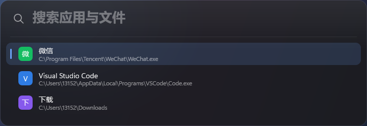
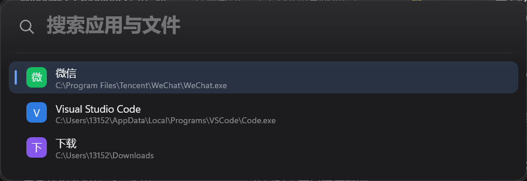

# eTools

Windows 11 上的高性能启动器（Spotlight / Raycast 风格）：热键唤出、输入即搜、回车启动应用与文件。C++20 + Win32 + Direct2D/DirectWrite + DirectComposition，免安装、免管理员、单 exe。

**当前进度：P0（工具链与渲染闸门）已完成，下一步进入 P1 视觉骨架。**

## 系统要求

- **Windows 11 22H2（build 22621）及以上，x64**。只使用系统自带的云母/圆角与 DirectComposition，不提供 Win10 视觉回退。
- 免管理员、免安装；无外部运行库依赖（静态链接，UCRT 为 Win10+ 系统组件）。
- 启动时校验系统版本，低于要求会明确提示并退出（P1 落地）。





## 已实现（P0）

- 免安装 MinGW-w64 工具链获取脚本：下载、SHA256（GitHub API digest）校验、解压到 `.toolchain/`。
- 一键增量构建 `build.ps1`：资源与清单嵌入、`-static -s` 单文件、Release 产物约 280KB、链接约 160ms。
- DirectComposition + D3D11 翻转模型交换链 + Direct2D：透明圆角窗口，**真实桌面内容可透过面板**（已用屏幕合成截图验证）。
- Win11 云母背景：`DWMWA_SYSTEMBACKDROP_TYPE` 在 DComp 窗口上生效，桌面文字不再透出，呈现壁纸模糊质感。
- 离屏 PNG 自检：窗口与离屏共用同一份 `DrawScene`，可按 DPI/主题/查询词出图，便于逐轮核对视觉。
- 视觉基线：720×248 DIP、16px 圆角、1px 内描边、28px 输入框、44px 行高、选中态强调条、顶部柔光。
- 中文排版、灰度抗锯齿、Per-Monitor V2 DPI 缩放、窗口 DPI 自适应。

## 构建

```powershell
# 仅首次：下载并校验 MinGW-w64（264MB，解压约 1.5GB 到 .toolchain/，不写入系统 PATH）
node tools/fetch-toolchain.mjs

# 构建（执行策略受限时用 Bypass 形式；脚本输出为 ASCII，避免 PS 5.1 编码问题）
powershell -ExecutionPolicy Bypass -File .\build.ps1

# 调试构建 / 测试 / 构建后启动
powershell -ExecutionPolicy Bypass -File .\build.ps1 -Config Debug
powershell -ExecutionPolicy Bypass -File .\build.ps1 -Config Test
powershell -ExecutionPolicy Bypass -File .\build.ps1 -Run
```

## 运行探针

```powershell
.\build\eTools.exe                                     # 显示窗口 1.5 秒后退出
.\build\eTools.exe --shot=out.png --scale=1.5 --query=微  # 离屏渲染（含模拟壁纸）
.\build\eTools.exe --mica --capture=cap.png             # 显示窗口并截取真实合成结果
.\build\eTools.exe --glass --capture=cap.png            # 低透明度，观察桌面透出
.\build\eTools.exe --ms=800                             # 自定义自动退出时长
```

| 参数 | 说明 |
| --- | --- |
| `--shot=<png>` | 离屏渲染并保存 PNG（不创建窗口） |
| `--capture=<png>` | 显示窗口约 0.45s 后截取窗口区域（含 DWM 合成结果） |
| `--query=<text>` | 设置输入框内容（空态/有内容两种版式） |
| `--scale=<factor>` | 渲染缩放（1 = 100%，1.5 = 150%） |
| `--glass` | 面板透明度降到 0.35，便于验证透明 |
| `--mica` | 启用 DWM 云母背景并打印 HRESULT |
| `--ms=<n>` | 自动退出时长（毫秒） |

## 目录

```
src/probe/main.cpp      P0 渲染探针（P1 起拆分到 ui/ search/ platform/ 等模块）
assets/app.rc           图标/清单/版本资源
assets/app.manifest     Per-Monitor V2、长路径、UTF-8、asInvoker
tools/fetch-toolchain.mjs  工具链获取与校验
build.ps1               构建脚本（增量、资源、静态链接）
docs/DESIGN.md          架构决策、实测结论、视觉 token
docs/images/            设计基线与真实合成截图
```

## 已知事项

- 链接时 binutils 2.47 会输出 `.rsrc merge failure: multiple non-default manifests`，属**非致命诊断**：清单与版本资源均已正确嵌入（`permonitorv2` 字符串可从 exe 中检出）。
- `build.ps1` 需以 `-ExecutionPolicy Bypass` 运行，或自行调整本机执行策略。
- 探针是 P0 验证代码，P1 起按 `ui/`、`search/`、`platform/`、`core/` 拆分。

## 路线

| 阶段 | 内容 |
| --- | --- |
| P0 ✅ | 工具链、构建、DComp/D2D 透明窗口、离屏自检、视觉基线 |
| P1 | 视觉骨架：主题 token、静态列表、多主题/多 DPI 基线、窗口定位 |
| P2 | 自绘输入框 + IME、虚拟列表、键盘/滚动、动效 |
| P3 | 应用索引（开始菜单/AppsFolder/App Paths）、评分、启动、图标 |
| P4 | 文件索引（根目录、快照、watcher）、路径直通 |
| P5 | 设置窗、托盘、自启、图标缓存、打磨与文档 |
