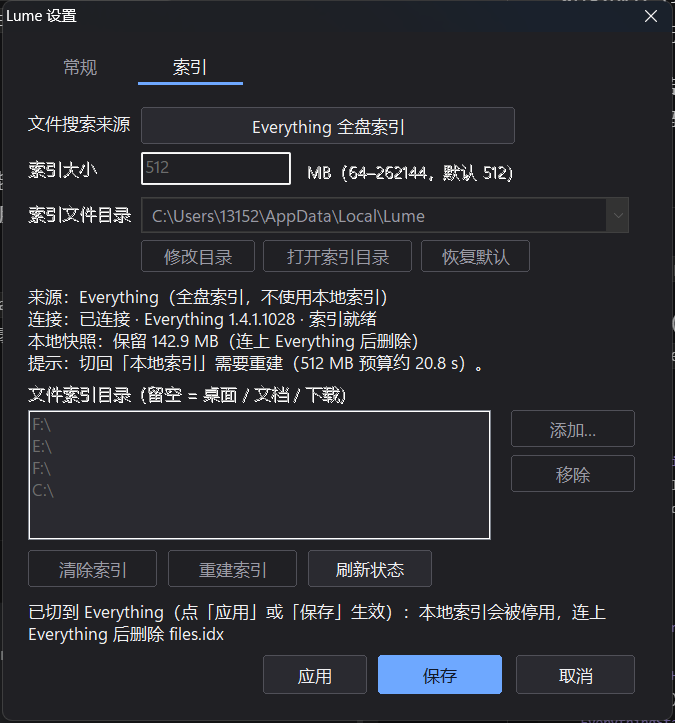
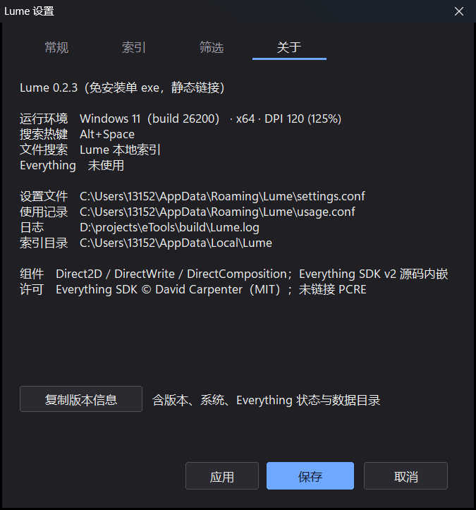
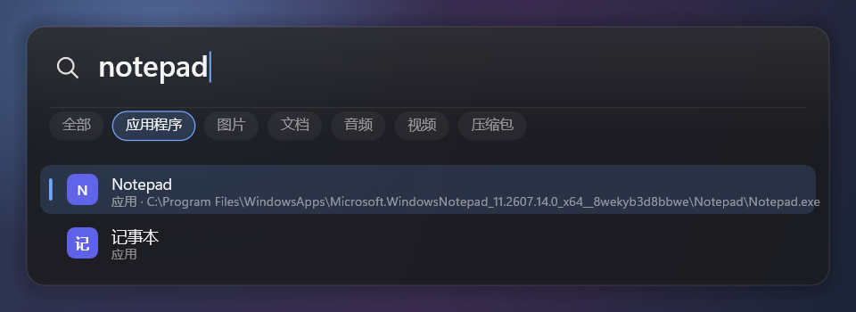
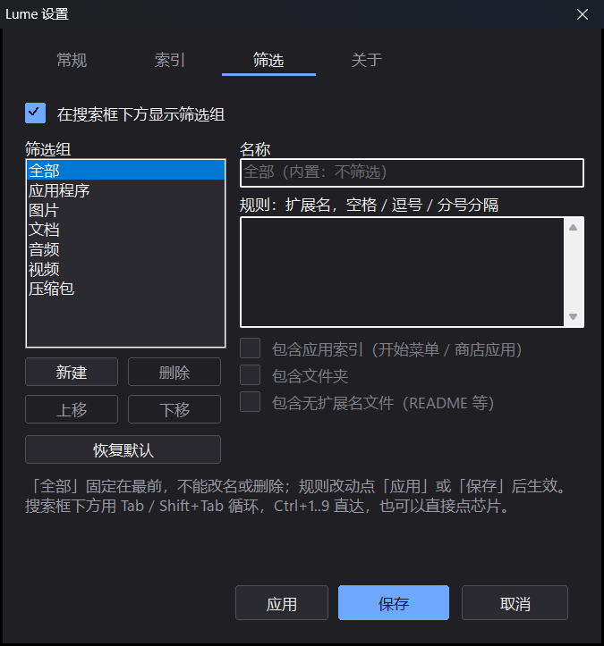
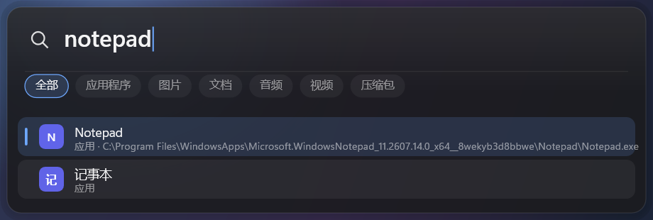

# Lume

Windows 11 上的高性能启动器（Spotlight / Raycast 风格）：热键唤出、输入即搜、回车启动应用与文件。C++20 + Win32 + Direct2D/DirectWrite + DirectComposition，免安装、免管理员、单 exe。

**当前版本：0.2.3。**Windows 11（build 22621+）x64，免安装单 exe；发布包在 `dist\Lume-0.2.3-win64.zip`。

**当前进度：P6 搜索质量修复（紧凑索引、按大小限制、精确匹配优先），P6.4 筛选组已完成。**


## 系统要求

- **Windows 11 22H2（build 22621）及以上，x64**。只使用系统自带的圆角与 DirectComposition（系统云母 P6.5 起关闭，见该节），不提供 Win10 视觉回退。
- 免管理员、免安装；无外部运行库依赖（静态链接，UCRT 为系统组件）。
- 启动时校验系统版本，低于要求弹出明确提示并退出。

## 已实现

**P0：工具链与渲染闸门**

- 免安装 MinGW-w64 工具链获取脚本：下载、SHA256（GitHub API digest）校验、解压到 `.toolchain/`。
- 一键增量构建 `build.ps1`：资源/清单嵌入、`-static -s` 单文件；当前产物约 315KB，链接约 170ms。
- DirectComposition + D3D11 翻转模型合成交换链 + Direct2D：透明圆角窗口，真实桌面内容可透过面板（已用屏幕合成截图验证）。
- Win11 云母背景：`DWMWA_SYSTEMBACKDROP_TYPE` 在 DComp 窗口上生效（**P6.5 起关闭**：它会把面板外那圈透明区域填成实色方块）。
- 离屏 PNG 自检：窗口与离屏共用同一份绘制代码。

**P1：视觉骨架 + 唤出链路**

- 模块化拆分：`core/`、`platform/`、`ui/`、`app/`（见下方目录）。
- 主题 token 化：暗/亮/跟随系统；尺寸、颜色、字号集中定义；默认强调色为设计蓝 `#6EA8FF`，可 `--accent=system` 跟随系统。
- 系统版本门禁（build ≥ 22621）、Per-Monitor V2 DPI、按光标显示器定位（水平居中、垂直 18%）。
- 全局热键 `Alt+Space`（冲突时自动尝试 `Ctrl+Alt+Space`、`Ctrl+Shift+Space`）；失焦自动隐藏、Esc 隐藏。
- 单实例：重复启动会把已有实例唤到前台。
- 隐藏预热渲染 + 同步出帧：**显示→首帧实测 13–14ms**（ShowWindow ~12ms + 绘制 ~1.7ms）。
- 3 DPI × 2 主题基线矩阵。

**P2：输入 / IME / 列表交互 / 动效**

- 自绘单行输入：UTF-16 码点级左右移动、退格/删除、Home/End、Ctrl+V 粘贴（清洗换行）、光标闪烁。
- IME 接入：`WM_IME_START/COMPOSITION/ENDCOMPOSITION`、`GCS_COMPSTR`/`GCS_RESULTSTR`/`GCS_CURSORPOS`；组字串带下划线渲染，`ImmSetCompositionWindow(CFS_POINT)` 跟随光标定位候选窗，`ImmSetCompositionFontW` 同步字号。
- 虚拟化列表：12 条样例、可见 6 行、滚动窗口只绘制可见行；↑↓/PgUp/PgDn/Home/End 选择并自动滚动。
- 键盘语义：Enter 记录启动（P3 接真实启动）、Shift+Enter/Ctrl+Enter 预留、Esc 取消组字或隐藏。
- 动效：唤出 90ms 淡入、选中迁移 120ms 缓动、结果刷新 80ms 淡入；QPC 帧计时器按需启停。
- 资源缓存：查询布局按「显示文本 + 组字区间」缓存，行布局按内容签名缓存，光标/组字只在变化时重建。
- 自动化验证钩子：`--type`（输入）、`--keys`（按键序列）、`--compose`（注入组字）、`--capture-ms`（任意时刻截图）。
- 3 DPI × 2 主题基线 + 输入/组字/淡入状态截图：`docs/images/p2/`。

**P3：应用索引 / 评分 / 真实启动 / 图标**

- 索引三源合并：开始菜单 `.lnk`（`IShellLinkW` 解析真实目标）、`shell:AppsFolder`（`IPropertyStore` 读 `PKEY_AppUserModel_ID`，覆盖商店应用）、注册表 `App Paths`；按标题与解析后目标双重去重。
- 磁盘缓存：`%LOCALAPPDATA%\Lume\apps.idx`（不可写时退回 exe 同目录），开始菜单目录有更新则自动重建；实测 **首次 650ms → 缓存 1.1ms**。
- 模糊评分：子串命中（前缀加分）、子序列命中（连续/词首加分）、长度惩罚；`--list-apps` 可直接检查索引内容。
- 真实启动：Shell 条目走 `ShellExecuteEx`（`.lnk` 保留参数/工作目录/清单），商店应用走 `IApplicationActivationManager::ActivateApplication`（失败回退 `shell:AppsFolder\<AUMID>`）；`Ctrl+Enter` 以管理员运行，`Shift+Enter` 打开所在位置。
- shell 图标：`IShellItemImageFactory` 取 32px → WIC 转 `32bppPBGRA` → D2D 位图，内存缓存（失败也缓存避免重试），无图标时回退首字色块。
- 过滤结果实时刷新，无匹配时显示占位行。

**P4：文件/文件夹搜索**

- 默认索引桌面、文档、下载；`FindFirstFileExW(FIND_FIRST_EX_LARGE_FETCH)` 多线程枚举，跳过 reparse point 与 `.git/node_modules` 等噪声目录；上限按**索引文件大小**设置（默认 512MB，最大 256GB），每个根目录平分预算。
- 二进制快照 `files.idx`（ETF4：目录树 + 名字 arena + 条目数组；AppData 不可写时退回 exe 同目录）；常驻启动先读最新快照再后台重建，首次/手动清除时写回。
- 每个根目录 `ReadDirectoryChangesW` 递归监听：新增文件立即入索引、删除即摘除、目录/重命名触发防抖重建；窗口 1s 内自动刷新结果。
- 查询与应用共用评分器（文件名命中加权，路径命中降权）；实测 **0.4–0.6ms**（1361 文件 / 228 应用），路径直通输入可直接打开。
- 异步图标：worker 取 shell 位图、UI 线程转 D2D，先画首字色块兜底；查询延迟从 56.7ms 降到 0.6ms。
- `--list-files` / `--file-stats` / `--file-root` 可检查索引；`--open` 可单独验证打开路径。

**P5：托盘、设置、自启、动态高度、MRU**

- 托盘图标 + 右键菜单（显示 / 开机自启 / 设置… / 退出），左键切换窗口；资源管理器重启后通过 `TaskbarCreated` 自动重挂。
- 设置窗（原生控件）：主题（跟随系统/深色/浅色）、强调色（设计蓝/系统）、热键预设（Alt+Space / Ctrl+Alt+Space / Ctrl+Shift+Space）、开机自启、文件索引目录增删（文件夹选择器）。
- 设置持久化 `settings.conf`（UTF-8 key=value，AppData 不可写时退回 exe 同目录）；改动即时应用：主题/强调色重绘、热键重新注册、文件索引按新根目录重建。
- 开机自启写 `HKCU\...\Run`（命令 `"Lume.exe" --autostart`）。
- 动态面板高度：结果 1–6 行时窗口高度跟随收缩/展开，不再固定留白。
- MRU：`usage.conf` 记录目标的使用次数与最近时间；**空查询只推荐使用记录里“最常用 + 最近”的条目**（应用与文件都在内，按热度排序，每次唤出前重建），没有使用记录时列表为空、面板只剩输入框；非空查询叠加 0–200 分。
- 修复：多份索引快照并存时，按“根目录匹配”逐个尝试，而不是读到第一份就放弃。
- 说明：本 agent 沙箱内 `Shell_NotifyIcon` 与 `HKCU\...\Run` 写入被系统拒绝（托盘/自启代码路径需在真实会话验证）；设置窗仍是原生浅色控件，深色主题留作 P5.1。

**P5.1：图标磁盘缓存 / 深色设置窗 / 自定义热键 / 自检**

- 图标磁盘缓存：worker 先查 `%LOCALAPPDATA%\Lume\icons\<hash>.png`（不可写时 exe 同目录），未命中才走 shell 取图并写回 PNG；`Warm()` 启动预热、异步队列走同一路径。实测冷启动 **12 次 shell 取图、首帧 29.4ms**，二次启动 **12 次磁盘命中、0 次 shell、首帧 15.6ms**。
- 设置窗自绘深色：统一 `#202024` 背景/白色文字，主题与强调色改为自绘循环按钮（跟随系统 → 深色 → 浅色），文件目录列表与按钮全部深色，去掉原生 ComboBox 的白色箭头块。
- 自定义热键：新增 `ParseHotkey`/`FormatHotkey`（Ctrl/Alt/Shift/Win + 字母/数字/F1–F24/方向键等），设置窗内点击热键框后直接按下组合键捕获，并用 `RegisterHotKey` 预检冲突；配置里可写任意组合（如 `Ctrl+Alt+K`）。
- 捕获期间用 `WH_KEYBOARD_LL` 低级钩子取原始按键，**修复 Ctrl+Space 被输入法吞掉、只显示 Ctrl 的问题**；同时放行 Alt+Tab / Alt+F4 / Esc，避免捕获时卡住系统快捷键。实测 Ctrl+Space、Ctrl+Alt+K 均能正确捕获。
- `--hotkey=<combo>` 可临时覆盖热键（不影响已保存设置），用于验证解析与注册。
- `--self-check`：一次性检查热键注册、托盘、自启读写、文件打开、设置写入并输出 `PASS/FAIL`；配合 `tools/regression.ps1` 在**真实桌面会话**做回归。
- 真实会话自检（2026-10-31，Windows 11 25H2 26200）：`hotkey/tray/autostart/open/settings_save` 全部 PASS；沙箱里 tray/autostart/open 会失败属环境限制。

**P6.2：Everything 可选文件搜索来源（2026-11-01）**



- **来源可切换**：设置 → 索引 → 「文件搜索来源」= `Lume 本地索引` ⇄ `Everything 全盘索引`（点「应用/保存」生效，存 `settings.conf` 的 `fileSearch=`）。
- **切到 Everything 时**：本地索引线程全部停止（枚举、`ReadDirectoryChangesW` watcher、快照读写），内存索引清空，`files.idx` **删除**（日志「已切到 Everything，删除本地快照」）；索引页里本地专用控件整体禁用。
- **未连上不误删**：Everything 没运行/没装时只提示原因并保留 `files.idx`，等它连上后补删——避免切过去后既没有 Everything 也没有本地索引。
- **官方 SDK 源码编进 exe**：`third_party/everything/`（官方 `include/Everything.h` + `ipc/Everything_IPC.h` + `src/Everything.c`，MIT，逐字节未改动，SHA256 见该目录 README）。不随包发 DLL、仍单 exe，也没有「找不到 DLL → 降级」的运行期失败模式；`tools/fetch-everything-sdk.mjs` 可复现下载与校验（整包 SHA256 `F5716D95…`）。
- **非阻塞查询**：`Everything_SetReplyWindow` + `Everything_Query(FALSE)`，回复走 `WM_COPYDATA` 回主窗口，用查询生成号丢弃过期回复；打字时 UI 不被阻塞（实测「过滤」0.3–2.5 ms，Everything 往返 ~25 ms）。
- **排序口径不变**：Everything 只提供候选（单次最多 500 条），仍用本地评分算 `score`/`quality`，分层（应用 → 可执行文件 → 文件 → 目录 → 仅路径）与本地一致；应用索引、图标、MRU、启动链路都不受影响。
- **查询净化**：去掉 `& | ! < > * ? "` 等 Everything 语法字符，含 `:` 或路径分隔符的词加引号，避免用户输入被当成 `regex:` / `content:` 触发内容搜索。
- **诊断**：`--everything-check[=<query>]` 打印连接状态、版本、命中与耗时，并用同一批命中过一遍合并层；`--self-check` 增加 `everything=PASS/SKIP/FAIL`；`--search-rows` 等仍只操作本地索引，但会打印 `file_search=<mode>` 口径行。
- 实测（Windows 11 26200 / Everything 1.4.1.1028 / 索引约 116 万文件）：`--everything-check=notepad` 命中 80 条、20 ms；exe 体积 +27 KB（2008 → 2063 KB）。

**P6.3：设置窗「关于」页（2026-11-01）**



- **第三个页签「关于」**（在最后），只读展示：版本（`Lume <版本号>`）、运行环境（`Windows 11（build 26200） · x64 · DPI 120 (125%)`）、当前热键、文件搜索来源、Everything 版本与连接状态，以及 `settings.conf` / `usage.conf` / 日志 / 索引目录四个路径。
- **「复制版本信息」**：把上面整段（含路径与组件许可）写到剪贴板，方便反馈问题；状态行提示「版本信息已复制到剪贴板」。
- **版本单一来源**：代码里新增 `src/app/version.h`（`kAppName`/`kAppVersion`），`--version`、用法文本与关于页都读它；改版本时它与 `assets/app.rc`、`assets/app.manifest`、`build.ps1 -Version` 四处一起改（`version.h` 里有注释提醒）。
- 关于页不做自动刷新：只在切到该页时读一次（与索引页一致，避免静态文本反复重绘）。

**P6.4：搜索筛选组（2026-11-01）**





- **搜索框下方常驻一排筛选芯片**：默认 `全部 / 应用程序 / 图片 / 文档 / 音频 / 视频 / 压缩包`，当前组用强调色描边高亮；芯片放不下时整行左移、当前组始终完整可见。**鼠标点击**、`Tab` / `Shift+Tab` 循环、`Ctrl+1..9` 直达三种方式都能切换。
- **一组 = 扩展名白名单 + 三个开关**：`包含应用索引`（开始菜单 / 商店应用 / App Paths）、`包含文件夹`、`包含无扩展名文件`（README 之类）。按 `.` 之后的扩展名匹配、不区分大小写；默认只给「应用程序」打开「包含应用索引」，所以选「图片」时开始菜单应用会一起消失。
- **设置 → 筛选页（第 3 个页签）**：新建 / 删除 / 上移 / 下移 / 改名 / 改规则（空格、逗号、分号都能分隔，`*.PNG` 归一成 `png`）/ 三个开关 / 一键「恢复默认」。`全部` 固定在最前，不能改名或删除；校验在点「应用 / 保存」时做，重名、空规则、超过 12 组都会被拦下并在状态行说明原因。
- **两种来源口径一致**：本地索引在**候选打分之后**过滤（不增加扫描开销，也不会因为先截断 80 条而漏掉同类型命中）；Everything 模式下纯扩展名组会把 `ext:png;jpg;…` 下推进查询串（候选集直接变小），结果仍按组规则再过滤一遍——若下推后 0 条，会自动去掉下推重试一次（**延后到消息循环里发**：Everything 投递回复是同步 `SendMessage`，在回复处理里再查询会互相等待，表现成切组时卡 3 秒；已踩过并修好）。
- **空查询与直达路径**：空查询时 MRU 推荐同样按组过滤；直接输入完整路径时该行不受筛选影响（仍可回车打开）。没有匹配时占位行提示「没有符合「图片」的结果 · 按 Tab 换一组，或切回「全部」」。
- **持久化**：`settings.conf` 新增 `filterEnabled=` / `filterActive=` / `filterGroup=名称|exe;png|apps|folders|noext`（可重复，顺序即芯片顺序，`version=3`）；切组时立即写盘，下次唤出仍停在同一组。
- **诊断**：`--filter=<名称|序号|all|off>` 覆盖本次运行的筛选组，`--list-filters` 打印解析后的组与规则，`--search-rows` / `--search-files` / `--search-live` / `--everything-check` 都会多打印一行 `filter=`；`--self-check` 增加 `filters=PASS`（默认组校验 + 编码/解码往返 + 扩展名匹配抽检）。
- 实测（Everything 1.4.1.1028 / 约 116 万文件）：`--everything-check=photo --filter=图片` 的查询串是 `photo ext:png;jpg;…`，命中 80 条 / 22ms；`--everything-check=notepad --filter=应用程序` 查 `notepad ext:exe;lnk;…`，12 条文件命中 + 2 条应用行；面板内切组 1–3ms（含重发查询）。

**P6.5：结果行鼠标操作 + 去掉窗口外框（2026-11-01）**



- **结果行可以用鼠标点开了**：指针移到行上给浅色高亮 + 手型光标，单击即启动 / 打开（`Shift` 定位、`Ctrl` 管理员，与回车同一套逻辑）。在此之前只有筛选芯片吃鼠标，列表必须用键盘。
- **抬起才启动**：`WM_LBUTTONDOWN` 只记住按下的行，`WM_LBUTTONUP` 落在同一行才执行——启动后鼠标抬起不会落进新打开的窗口；按下后拖到别的行（或拖出面板）不会误启动。
- **命中与绘制共用一套几何**：`Scene::RowAt()` 与列表绘制共用 `listTop` / `rowHeight` / `rowGap` / 滚动偏移，行间隙 4 DIP 不算命中；占位提示行（`RowAction::None`）不响应悬停与点击。
- **悬停不重抄数据**：`WM_MOUSEMOVE` 只改 `SceneState::hoverRow` / `hoverChip` 两个字段再 `InvalidateRect`，不复制 200 行结果（原先切芯片悬停会整份 `rows_` 拷贝）。
- **「搜索框外面那圈框」= 系统背景（Mica）**：`DWMWA_SYSTEMBACKDROP_TYPE=DWMSBT_MAINWINDOW` 填满的是**整个窗口矩形**（暗色下就是 `#202020` 的一整块），而我们的窗口为了放自绘阴影比面板大一圈 `shadowMargin`——于是面板外面那圈本该透明的区域被涂成不透明的方块，看着就是一个 20–30px 的框。现在 `ApplyBackdrop()` 改成 `DWMSBT_NONE`（注意它是 `1`，`0` = `DWMSBT_AUTO` 等于没关），窗口除自绘的面板与柔和阴影外完全透明；顺带把系统背景沿窗口矩形画的 1px 描边也关掉（`DWMWA_BORDER_COLOR = DWMWA_COLOR_NONE`）。面板自身那 1px 边线（`theme.border`）保留。
- **透明边距从 24 DIP 收到 8 DIP**：`Theme::shadowMargin` 现在决定窗口 = 面板 + 16 DIP（125% 缩放下每边约 10px）。原来 24 DIP 是为了放 6 层柔和阴影，但那圈「毛玻璃边」本身就容易被当成多余的框；现在阴影的扩散量被 `shadowMargin - 0.5` 夹住，只剩贴着面板的一圈薄阴影（8 DIP 时刚好是能看出投影、又不显宽的量），面板轮廓靠 `border` 的 1px + 圆角。`--shot` 输出的画布尺寸随之变小（面板尺寸不变，历史截图还是旧边距）。
- **验证方式**：在窗口背后垫一块纯品红窗口再 `--capture`。关云母之前窗口边缘那一圈是 `(32,32,32)` 的死色（品红一点透不出来，`#202020` 正是暗色云母的底色）；关云母之后变成品红渐变；边距收到 8 DIP 后，最外约 10px 是品红被阴影压暗的渐变（`225 → 221 → 218 → 211`），第 10px 起就是面板（`(62,38,65)` → `(50,24,53)`，面板 0.88 的 alpha 把品红吃成暗紫，毛玻璃观感仍在）。
- **副作用**：面板 0.88 的不透明度现在直接与桌面内容混合（以前叠在云母的壁纸模糊上），亮色壁纸下面板会略浅一点；觉得太透就把 `theme.panel` 的 alpha 抬到 0.93 左右。
- **诊断钩子**：`--hover-row=<n>` / `--click-row=<n>`（1 起）把鼠标消息投到第 n 行，`--shot` 配合 `--hover-row` 可以直接渲染悬停高亮截图；日志会打印 `悬停: 行 2 notepad`、`点击: [1] …`、`激活: [1] …`，用来验证坐标换算与启动链路（合成消息下 `TrackMouseEvent` 会立刻回 `WM_MOUSELEAVE`，所以悬停视觉验证走离屏渲染）。

**P6（进行中）：搜索质量修复**


- **应用索引与文件索引是两套**：`apps.idx` 来自开始菜单/AppsFolder/App Paths，天然包含 C 盘的系统应用；`files.idx` 只扫设置里的根目录（当前 **C:/F:/E:/D:**）。搜 `notepad` 第一条是 Notepad 应用，副标题显示 `应用 · C:\Program Files\WindowsApps\...`，下面的才是文件索引结果。启动日志会逐条打印 `文件索引根: C:\ / F:\ / E:\ / D:\`。
- 注意：`--file-stats` / `--list-files` 在未指定 `--file-root` 时使用默认的桌面/文档/下载（C 盘），这是诊断命令的默认值；要验证实际索引请用 `--search-live=<query>` 或 `--file-root=`。
- **上限改为“索引文件大小”**：设置窗“索引大小”以 MB 为单位，默认 **512**，范围 **64–262144**（最大 256GB）；也支持 `settings.conf` 的 `indexSizeMB=` 或 `--index-size-mb`。4 个根平均分配预算（512MB → 每根 128MB），按“4 字节长度 + UTF-16 路径 + 1 字节类型”的序列化大小累计，达到预算即停。旧的 `fileCap` 条目上限已移除，老配置直接使用 512MB 默认。
- **快照优先 + 后台重建**：启动先读最新的 `files.idx`（ETF4 紧凑格式，100 万条 **656ms** 可用），随后后台全量重建（512MB 预算下约 **20.8s**）。启动不删除/重写快照；首次或“清除索引并重建”才写回。写快照不会再触发自己的 watcher，目录高频变化有 60s 冷却，退出可取消，快照流式写临时文件后原子替换。
- **手动清除**：设置窗「索引」页的「清除索引」只删快照并清空内存（不自动重建），「重建索引」立即后台重建并写回快照（会跳过 watcher 的 60s 冷却）；两者替代了原来的「清除索引并重建」，`--clear-index` 仍按“删快照并重建”执行。
- **索引页（P6.1）**：设置窗拆成「常规 / 索引」两页。索引页集中索引大小上限、索引文件目录、索引状态（快照大小 / 条目数 / 上限占用率 / 重建中 / 上次重建耗时）、文件索引根目录增删，以及清除 / 重建 / 刷新状态三个动作。索引文件目录是**只读下拉框**（不能手打，鼠标可选中），列出当前目录、默认目录和最近用过的 5 个目录（**已经不存在的不显示**），下面一行是「修改目录 / 打开索引目录 / 恢复默认」。状态**不自动轮询**，需要时点「刷新状态」（避免状态块反复重绘闪烁）。窗口底部有 **应用 / 保存 / 取消**：应用=立即应用配置但不关窗，保存=应用并关闭，取消=丢弃本次修改。索引文件目录写入 `settings.conf` 的 `indexDir=`，历史写入 `indexDirHistory=`（最多 5 条；填默认目录会归一化成空值，留空 = `%LOCALAPPDATA%\Lume`；应用前校验绝对路径、可创建与可写）。
- **快照格式 ETF4**：目录按“父目录 id + 组件名”存，条目不存完整路径；名称放在连续 arena，条目固定 29 字节字段。**230MB → 124.4MB**（999,842 条，130,480,000 字节）。
- **512MB 预算实测**：999,842 条、快照 **124.4MB**（预算按完整路径保守估算，所以实际文件小于 512MB），重建 20.8s；进程 **323MB 常驻 / 410MB 峰值**（无快照首次），读快照后再重建峰值约 560MB。查询 `AlanWake2.exe` **4.8ms**。
- **存储占用**：`files.idx` **124.4MB**、`apps.idx` **48KB**、日志/图标/配置 **0.83MB**，正常会话总计约 **125MB**。沙箱写不进 AppData 时快照落在 exe 同目录（本机还残留旧的 170MB AppData 快照，所以看起来更大）；启动取最新修改时间的那份，正常会话只有一份。
- **紧凑索引**：目录表 + 文件名 arena，条目 32B；47 万条索引 83MB、进程 123MB。字符位图预筛、1–2 字符只做子串、路径命中仅最后兜底（查询≥3、分数÷6、最多 2000 条）。
- **匹配质量优先**：`quality`（5 直接路径 / 4 字面完全一致 / 3 忽略扩展名一致 / 2 前缀 / 1 子串 / 0 模糊或路径）→ 类型 tier（应用、可执行文件 → 其他文件 → 目录 → 仅路径）→ 分数。
- **启动工作目录**：打开文件/直接 exe 时把 `ShellExecuteEx` 的 `lpDirectory` 设为文件所在目录（`.lnk` 例外，保留快捷方式自带的工作目录），修复游戏按自身目录找 `data` 却跑到启动器目录的问题；版本资源改为 ASCII 描述，避免任务管理器显示乱码。
- **光标缓存修复**：查询布局缓存之前只按文本/组字区间判断，左右/Home/End 移动光标时视觉光标不动。现在文本不变时单独重算 `HitTestTextPosition` 并处理左右滚动，光标会跟随实际插入点（长查询滚动也正确）。
- **正式版外壳**：主程序改为 Windows GUI 子系统，双击运行不再出现黑色控制台窗口；命令行模式会复用继承的 stdout 或附加父控制台（`--version`、`--list-apps` 等仍可用）。退出统一走托盘菜单，避免误关窗口把常驻进程带走。
- **托盘图标**：使用蓝底白色镜头的独立高对比图标（`assets/tray.ico`），深/浅色任务栏都可见；如果在托盘找不到，先检查任务栏溢出区（^）并拖到常驻区。
- 仍未解决：子序列噪声；非精确目录仍排在文件后；230MB 快照可进一步改成目录树+名字 arena 压缩。

## 构建

```powershell
# 仅首次：下载并校验 MinGW-w64（264MB，解压约 1.5GB 到 .toolchain/，不写入系统 PATH）
node tools/fetch-toolchain.mjs

# 可选：重新获取 Everything SDK 源码（third_party/everything/ 已入库，通常不用跑）
# 有本地 zip 时优先复用：--local=<Everything-SDK.zip>；校验整包 SHA256 后只解出所需 3 个文件
node tools/fetch-everything-sdk.mjs

# 构建（执行策略受限时用 Bypass 形式；脚本输出为 ASCII，避免 PS 5.1 编码问题）
powershell -ExecutionPolicy Bypass -File .\build.ps1

# 调试构建 / 测试 / 构建后启动
powershell -ExecutionPolicy Bypass -File .\build.ps1 -Config Debug
powershell -ExecutionPolicy Bypass -File .\build.ps1 -Config Test
powershell -ExecutionPolicy Bypass -File .\build.ps1 -Run
```

## 发布包

```powershell
# 编译 + 打 zip 发布包（版本号同时用于目录/文件名，需与 assets/app.rc 一致）
powershell -ExecutionPolicy Bypass -File .\build.ps1 -Recompile -Package
# 产物：dist\Lume-0.2.3-win64.zip（以及同名目录，便于先本地试跑）
```

压缩包内容：`Lume.exe`（单文件、静态链接）+ `Install.cmd` + `README.txt`（系统要求、快捷键、首次索引、卸载）。解压即用，不需要安装。`README.txt` 模板在 `packaging\README.txt`；`-Package` 会校验 exe 的 `ProductVersion` 与 `-Version`（默认 `0.2.3`）一致，并打印 zip 的 SHA256。

### 低完整性环境（DSH/受限工作区）

如果直接从 `D:\projects\eTools` 这类被标记为 **Low Integrity** 的工作区运行，Windows 的 UIPI 会阻止 `Shell_NotifyIcon`，表现为没有托盘、日志里 `托盘图标创建失败 (Win32 5)`，且日志落在 exe 同目录而不是 `%LOCALAPPDATA%\Lume\logs`。

解决办法：双击发布包里的 **`Install.cmd`**，它会复制到 `%LOCALAPPDATA%\Programs\Lume` 并从普通目录启动；或手动把 `Lume.exe` 复制到桌面/`C:\Apps\Lume` 再运行。普通用户目录下不会有这个问题。

## 运行

```powershell
.\build\Lume.exe                       # 常驻：按 Alt+Space 唤出/隐藏
.\build\Lume.exe --show --ms=3000      # 直接显示 3 秒（便于测试）
.\build\Lume.exe --capture=cap.png     # 显示并截取真实合成结果
.\build\Lume.exe --shot=out.png --scale=1.5 --theme=light
.\build\Lume.exe --shot=out.png --query=photo --filter=图片   # 带筛选芯片的离屏图
.\build\Lume.exe --shot=out.png --query=photo --hover-row=2   # 连第 2 行的鼠标悬停高亮一起画出来
.\build\Lume.exe --click-row=2 --query=notepad               # 合成一次鼠标单击（日志里有 点击/激活）
.\build\Lume.exe --shot-matrix=docs\images\p2   # 生成 3×2 基线矩阵
.\build\Lume.exe --list-filters                # 打印筛选组与规则（UTF-8）
.\build\Lume.exe --bench-search=8000000        # 内存里造 800 万条假条目压测搜索（见下方「压力测试」）
.\build\Lume.exe --type=cod --keys=down,down    # 输入与选择（配合 --capture）
.\build\Lume.exe --list-apps                    # 打印真实应用索引（UTF-8，每行一条）
```

| 参数 | 说明 |
| --- | --- |
| `--show` | 启动后立即显示（否则等待热键） |
| `--ms=<n>` | 启动后 n 毫秒自动退出 |
| `--capture=<png>` | 显示约 0.45s 后截取窗口区域（含 DWM 合成结果） |
| `--shot=<png>` | 离屏渲染（模拟壁纸），不创建窗口 |
| `--shot-matrix=<dir>` | 生成 3 DPI × 2 主题基线 |
| `--theme=dark\|light\|system` | 主题，默认跟随系统 |
| `--accent=system\|#RRGGBB` | 强调色，默认设计蓝 `#6EA8FF` |
| `--query=<text>` | 预填输入框文字 |
| `--scale=<factor>` | 截图缩放（1 = 100%） |
| `--glass` | 面板不透明度降到 0.35，检查桌面透出 |
| `--type=<text>` | 显示后依次注入字符（输入验证） |
| `--keys=up,down,enter` | 显示后注入按键序列（支持 up/down/left/right/home/end/pgup/pgdn/enter/esc/back/delete） |
| `--compose=<text>` | 注入 IME 组字串，验证组字渲染 |
| `--capture-ms=<n>` | 截图延迟（默认 450；用 30 观察淡入帧） |
| `--selected=<n>` | 离屏截图时预选中第 n 行 |
| `--hover-row=<n>` | 把鼠标悬停投到第 n 行（1 起）：离屏截图会画出悬停高亮 |
| `--click-row=<n>` | 用合成的鼠标消息单击第 n 行（1 起），验证命中与启动链路 |
| `--list-apps` | 打印应用索引（UTF-8，每行一条） |
| `--list-files` | 重建文件索引并打印统计与前 20 条路径 |
| `--file-stats` | 重建文件索引并只打印统计 |
| `--file-root=<dir>` | 覆盖文件索引根目录（测试用） |
| `--open=<path>` | 单独验证打开文件/路径 |
| `--set-autostart=1\|0` | 设置开机自启并打印状态 |
| `--hotkey=<combo>` | 临时覆盖热键（如 `Ctrl+Alt+K`） |
| `--test-capture=<combo>` | 测试用：打开设置窗并合成组合键，验证捕获 |
| `--search-files=<query>` | 搜索文件索引并打印耗时与前 20 条（分数+路径） |
| `--search-rows=<query>` | 打印合并后的 tier/分数/标题/路径（验证排序） |
| `--index-size-mb=<n>` | 覆盖索引大小上限（64–262144 MB，测试/调优） |
| `--index-dir=<dir>` | 覆盖索引快照目录（默认 `%LOCALAPPDATA%\Lume`） |
| `--search-live=<query>` | 现场重建索引并搜索（诊断上限/排序） |
| `--file-search=local\|everything` | 覆盖文件搜索来源（只影响本次运行） |
| `--filter=<name\|index\|all\|off>` | 覆盖筛选组（序号从 1 起，1 = 全部；`off` = 关闭筛选） |
| `--list-filters` | 打印筛选组、规则与当前选中项（验证 settings.conf 解析） |
| `--bench-search[=<n>]` | 在内存里造 n 条假条目（默认 100 万）并跑真实搜索，打印 min/med/p95 |
| `--bench-iters=<n>` | 每个基准用例的迭代次数（默认 5） |
| `--everything-check[=<query>]` | 检查 Everything 连接/版本，跑一次查询并打印命中与合并结果 |
| `--settings` | 启动时打开设置窗 |
| `--self-check` | 检查热键/托盘/自启/打开文件/设置写入并打印 PASS/FAIL |
| `--no-hotkey` | 不注册全局热键 |
| `--log=<path>` | 指定日志文件（默认 `%LOCALAPPDATA%\Lume\logs`，不可写时退回 exe 同目录） |

## 压力测试（内存合成数据）

`--bench-search=<n>` 在内存里造 n 条假条目（目录表 + 名字 arena + charMask/pathHash 的填充方式与真实枚举一致），
然后跑**同一份** `FileIndex::Search()`：字符位图预筛 → 打分 → 筛选组过滤 → 排序截断。
造数据不参与计时；每个用例先预热一次，再取 min/med/p95。

```powershell
.\build\Lume.exe --bench-search=8000000            # 800 万条，约 467MB 常驻
.\build\Lume.exe --bench-search=1000000 --bench-iters=20
```

本机实测（Windows 11 26200 / i7 级 CPU，单位 ms，`hits` 固定截断到 80）：

| 条目 | 查询 | 全部 | 图片组 | 过滤增量 | 扫描吞吐 |
| --- | --- | --- | --- | --- | --- |
| 100 万 | report | 8.34 | 8.47 | +0.13 | 120 M/s |
| 100 万 | 2024 | 3.94 | 4.27 | +0.33 | 254 M/s |
| 100 万 | a（单字符） | 28.40 | 40.68 | +12.3 | 35 M/s |
| 100 万 | 文档（CJK） | 11.36 | 11.98 | +0.62 | 88 M/s |
| 400 万 | report | 31.80 | 34.77 | +2.97 | 126 M/s |
| 400 万 | a | 106.74 | 162.56 | +55.8 | 38 M/s |
| 800 万 | report | 63.55 | 69.60 | +6.05 | 126 M/s |
| 800 万 | a | 210.55 | 322.48 | +111.9 | 38 M/s |

结论：

- **扫描是线性、可预测的**：100 万 → 800 万，耗时严格 ×8（`report` 8.3 → 63.6 ms），吞吐稳定在 ~120–128 M 条/秒；数字型查询命中字符位图预筛，能到 ~250 M/秒。
- **过滤的边际成本只和「命中数」有关**：常规 3 字符以上查询 +0.1–6 ms（相对 +1–10%）；`a` 这种几乎命中全表的单字符查询是唯一明显变慢的情况（800 万时 +112 ms），因为每条命中都要过一次谓词。
- 谓词本身约 **70 ns/次**（2M 次重复调用，8/9/12 个扩展名的组几乎一样快——耗时在「取基名 + 找最后一个点」上，不在逐个比扩展名）。
- 常驻内存约 **76 B/条**（100 万 76MB / 400 万 244MB / 800 万 467MB），造数据 0.46 / 1.84 / 3.57 s。
- 合成数据比真实索引快（真实 116 万条实测 22–35 ms）：真实条目名更长、目录路径更分散、缓存局部性差，而且线上那条日志还包含合并层与窗口布局。

回归脚本已把这个基准挂成**防退化闸门**：`tools\regression.ps1` 默认跑 100 万条，检查 `bench_report` ≤ 60 ms、`bench_a_1char` ≤ 200 ms 与 `filter_check=ok`，超阈值即 FAIL；`-SkipBench` 跳过、`-BenchMs` / `-BenchShortMs` 调阈值、`-BenchEntries` 换数据量（参数用空格分隔，如 `-BenchMs 60`）。阈值按本机 8.3 / 26 ms 留了 7 倍余量，只拦「数量级变慢」。

## 目录

```
src/main.cpp               CLI 解析与入口分发
src/app/version.h          应用名与版本号（代码侧单一来源，改版本见文件内注释）
src/app/                   常驻应用：单实例、热键、显示/隐藏、截图模式、测试注入
src/app/settings.cpp       设置读写（settings.conf，多路径回退）
src/ui/window.cpp          窗口、托盘、设置入口、定位/激活、输入与 IME、键盘与鼠标、动效、动态高度
src/ui/settings_window.cpp 设置窗（常规 / 索引 / 筛选 / 关于四页）
src/ui/input.cpp           单行输入状态（码点移动、粘贴、组字）
src/ui/renderer.cpp        D3D11/DXGI/DirectComposition/D2D/DWrite/WIC 与出图
src/ui/scene.cpp           面板绘制（阴影、输入、筛选芯片、虚拟化列表、组字下划线、动画 Alpha）
src/ui/theme.cpp           暗/亮主题 token、强调色解析
src/platform/system.cpp    系统版本门禁、DPI、工作区、暗色/强调色读取
src/platform/hotkey.cpp    全局热键注册与预设组合
src/platform/autostart.cpp 开机自启注册表读写
src/platform/tray.cpp      托盘图标与右键菜单
src/search/app_entry.h     应用条目模型与索引/过滤接口
src/search/app_index.cpp   开始菜单/AppsFolder/App Paths 收集、去重、磁盘缓存
src/search/scorer.cpp      模糊评分与过滤
src/search/file_index.cpp  文件枚举、快照、watcher、文件检索
src/search/file_hit.h      文件命中模型（两个搜索来源共用）+ 单次上限
src/search/file_score.*    文件名/路径评分口径（本地索引与 Everything 共用）
src/search/everything_index.* Everything 文件搜索后端（官方 SDK 源码、非阻塞 IPC）
src/search/filter.*        筛选组模型、规整/校验、settings.conf 编解码、扩展名匹配
src/search/merge.cpp       应用/文件/路径直通合并排序
src/search/usage.cpp       使用频次/最近性（usage.conf）
src/search/result.h        显示层结果行
src/ui/icon_cache.cpp      异步 shell 图标加载（worker 取图 + UI 转 D2D）
src/launch/launcher.cpp    ShellExecuteEx / UWP 激活 / 定位 / 管理员运行 / 打开路径
src/core/log.*             日志（文件/调试器/控制台，UTF-8）与通用工具
assets/app.rc              版本/清单资源
assets/app.manifest        Per-Monitor V2、长路径、UTF-8、asInvoker
tools/fetch-toolchain.mjs  工具链获取与校验（锁定版本）
tools/fetch-everything-sdk.mjs  Everything SDK 获取与校验（SHA256，只解出所需源码）
third_party/everything/    Everything SDK 源码（官方原样，MIT，编进 exe 而不是带 DLL）
tools/regression.ps1       真实桌面会话回归（托盘/自启/热键/文件打开）
build.ps1                  增量构建脚本
docs/DESIGN.md             架构决策、实测数据、视觉 token
docs/images/p2/            P2 设计基线与交互状态截图
docs/images/p3/            P3 真实索引/图标/选中态截图
docs/images/p4/            P4 文件搜索/watcher/窗口截图
docs/images/p5/            P5 动态高度截图
docs/images/p6/            P6 排序修复 / Everything / 关于页 / 筛选组 / 悬停高亮截图
```

## 已知事项

- 链接时 binutils 2.47 会输出 `.rsrc merge failure: multiple non-default manifests`，属**非致命诊断**：清单与版本资源均已正确嵌入（`permonitorv2` 字符串可从 exe 中检出）。
- `build.ps1` 需以 `-ExecutionPolicy Bypass` 运行，或自行调整本机执行策略。
- 探针时代的 `--mica` 参数已移除；**系统云母现在是关掉的**（见 P6.5，它会把面板外那圈透明区域填成实色方块），`--shot` 不校验系统版本，便于任意机器生成设计图。
- 组字渲染已通过注入验证，**真实微软拼音/搜狗输入法的候选窗位置仍需人工确认**（自动化无法安全驱动系统 IME）。
- 现在没有系统云母：`--glass` 把面板不透明度降到 0.35 时，透出来的是桌面真实内容（不是壁纸模糊底）。面板常规态是 0.88，亮色壁纸下会带一点底色，属预期。
- **UWP 启动无法在本 agent 沙箱内验证**：`ActivateApplication` 与 `shell:AppsFolder\<AUMID>` 都被系统拒绝（Win32 5），连 PowerShell `Start-Process` 同样失败，属环境限制；普通 exe/.lnk 启动已实测成功。请在真实会话里用「记事本/计算器」确认。
- **用 shell 打开文件**：沙箱内 `.txt` 返回 Win32 5、`.exe` 返回 1223（取消）；**真实会话已通过**（`open=PASS`，默认编辑器成功打开自检文件）。
- 文件索引默认桌面/文档/下载，可在设置里添加盘符或目录（如 `C:\`、`D:\`）；它不是 USN 全盘秒搜，超大目录会受索引大小预算限制。要全盘秒搜请把「文件搜索来源」切到 Everything（见 P6.2）。
- **Everything 模式的限制**：需要 Everything 1.4/1.5 **正在运行**（SDK 只是 IPC 客户端；`--everything-check` 会打印 `available=0` 与原因）；只认默认实例的 IPC 窗口，1.5-alpha 的命名实例可能找不到；结果**不按**设置里的「文件索引目录」过滤；不支持内容搜索/正则（查询里的语法字符会被净化掉）；单次最多取 500 条候选再本地评分。
- **托盘与开机自启**：在 agent 沙箱内会被系统拒绝（`Shell_NotifyIcon` 返回失败、`HKCU\...\Run` 不可写），但**真实桌面会话已实测通过**（`regression.ps1` 五项全 PASS），不影响正常使用。
- 设置窗已改为自绘深色（主题/强调色循环按钮、热键捕获、深色列表与按钮）；设置保存路径优先 `%APPDATA%\Lume\settings.conf`，不可写时退回 exe 同目录。
- **筛选组**：芯片行（40 DIP）会让面板比之前高一点；关掉设置 → 筛选 → 「在搜索框下方显示筛选组」就回到旧几何。芯片放不下时只做裁剪，没有横向滚动条——被裁掉的组用 `Tab` / `Ctrl+1..9` 仍能选中。
- **筛选 + Everything**：含「文件夹 / 无扩展名」开关的组没法用 `ext:` 表达，只做本地后过滤，候选仍受「500 条、按名称升序」的上限影响，可能比预期少；纯扩展名组会下推，结果更全。
- **鼠标操作范围**：芯片切组、结果行点击启动、滚轮滚动；输入框里的拖选/右键菜单还没做（仍靠键盘 + `Ctrl+V`）。单击是「按下记住行、抬起才启动」，所以按住左键拖到别的行不会误启动。
- 图标缓存位于 `%LOCALAPPDATA%\Lume\icons`（沙箱等不可写环境退回 exe 同目录 `icons\`），按解析名哈希存 PNG；删掉目录会重新取图。
- 动态面板高度已实现（1–6 行）；文件内容搜索仍未做。
- **真实会话回归**：`powershell -ExecutionPolicy Bypass -File tools\regression.ps1` 已跑通（exit=0，含 self-check 与 100 万条 `--bench-search` 的防退化阈值）；后续改搜索/托盘/自启链路时重跑即可。人工项（托盘菜单、设置重启生效、注销后自启）仍建议过一遍。
- 唤出淡入通过场景整体 alpha 实现（mingw 的 `dcomp.h` 漏声明 `IDCompositionVisual::SetOpacity`，未用 ABI hack）。

## 路线

| 阶段 | 内容 |
| --- | --- |
| P0 ✅ | 工具链、构建、DComp/D2D 透明窗口、离屏自检 |
| P1 ✅ | 模块化、主题 token、热键/定位/显隐、单实例、系统门禁、多 DPI 基线 |
| P2 ✅ | 自绘输入 + IME、虚拟列表、键盘/滚动、唤出与选中动效、布局缓存 |
| P3 ✅ | 应用索引（开始菜单/AppsFolder/App Paths）、评分、真实启动、shell 图标、索引缓存 |
| P4 ✅ | 文件/文件夹索引、快照、watcher 增量、路径直通、异步图标 |
| P5 ✅ | 托盘/设置窗/自启、动态高度、MRU 排序、快照多路径修复 |
| P5.1 ✅ | 图标磁盘缓存、深色自绘设置窗、自定义热键、真实会话自检全 PASS |
| P6.1 ✅ | 设置窗「索引」页：索引文件目录可配置、快照大小/条目/重建状态、清除与重建分离、打开索引目录 |
| P6.2 ✅ | Everything 可选文件搜索来源（官方 SDK 源码编进 exe、来源切换、删除本地快照、非阻塞查询、状态页） |
| P6.3 ✅ | 设置窗「关于」页（版本/系统/数据目录、复制版本信息、版本单一来源） |
| P6.4 ✅ | 搜索筛选组（芯片切换、组规则可编辑、恢复默认、Everything `ext:` 下推与零结果重试） |
| P6.5 ✅ | 结果行鼠标操作（悬停高亮 + 单击启动，抬起才执行）与去掉 DWM 窗口外框 |
| P6（进行中） | 搜索质量修复（配额/路径降权/稳定排序/预筛）、文件内容搜索、打包与签名 |
