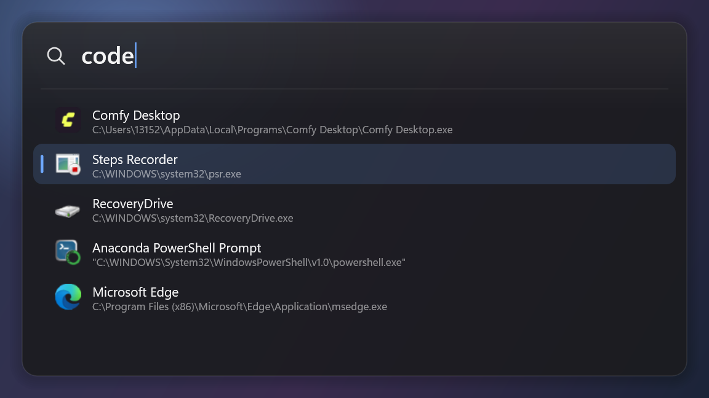
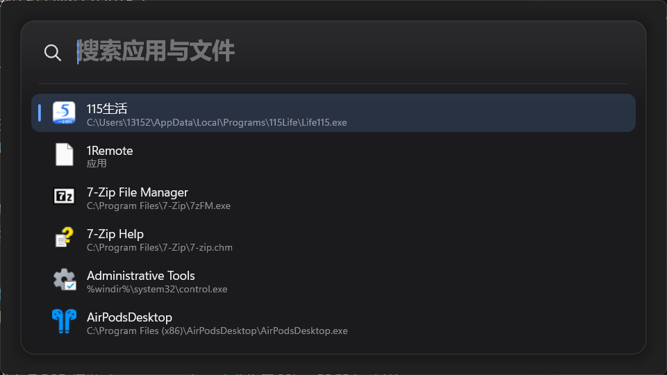

# eTools

Windows 11 上的高性能启动器（Spotlight / Raycast 风格）：热键唤出、输入即搜、回车启动应用与文件。C++20 + Win32 + Direct2D/DirectWrite + DirectComposition，免安装、免管理员、单 exe。

**当前进度：P3（应用索引 / 评分 / 真实启动 / shell 图标）已完成，下一步 P4 文件搜索。**





## 系统要求

- **Windows 11 22H2（build 22621）及以上，x64**。只使用系统自带的云母/圆角与 DirectComposition，不提供 Win10 视觉回退。
- 免管理员、免安装；无外部运行库依赖（静态链接，UCRT 为系统组件）。
- 启动时校验系统版本，低于要求弹出明确提示并退出。

## 已实现

**P0：工具链与渲染闸门**

- 免安装 MinGW-w64 工具链获取脚本：下载、SHA256（GitHub API digest）校验、解压到 `.toolchain/`。
- 一键增量构建 `build.ps1`：资源/清单嵌入、`-static -s` 单文件；当前产物约 315KB，链接约 170ms。
- DirectComposition + D3D11 翻转模型合成交换链 + Direct2D：透明圆角窗口，真实桌面内容可透过面板（已用屏幕合成截图验证）。
- Win11 云母背景：`DWMWA_SYSTEMBACKDROP_TYPE` 在 DComp 窗口上生效。
- 离屏 PNG 自检：窗口与离屏共用同一份绘制代码。

**P1：视觉骨架 + 唤出链路**

- 模块化拆分：`core/`、`platform/`、`ui/`、`app/`（见下方目录）。
- 主题 token 化：暗/亮/跟随系统；尺寸、颜色、字号集中定义；默认强调色为设计蓝 `#6EA8FF`，可 `--accent=system` 跟随系统。
- 系统版本门禁（build ≥ 22621）、Per-Monitor V2 DPI、按光标显示器定位（水平居中、垂直 18%）。
- 全局热键 `Alt+Space`（冲突时自动尝试 `Ctrl+Alt+Space`、`Ctrl+Shift+Space`）；失焦自动隐藏、Esc 隐藏。
- 单实例：重复启动会把已有实例唤到前台。
- 隐藏预热渲染 + 同步出帧：**显示→首帧实测 13–14ms**（ShowWindow ~12ms + 绘制 ~1.7ms）。
- 3 DPI × 2 主题基线矩阵。

**P2：输入 / IME / 列表交互 / 动效**

- 自绘单行输入：UTF-16 码点级左右移动、退格/删除、Home/End、Ctrl+V 粘贴（清洗换行）、光标闪烁。
- IME 接入：`WM_IME_START/COMPOSITION/ENDCOMPOSITION`、`GCS_COMPSTR`/`GCS_RESULTSTR`/`GCS_CURSORPOS`；组字串带下划线渲染，`ImmSetCompositionWindow(CFS_POINT)` 跟随光标定位候选窗，`ImmSetCompositionFontW` 同步字号。
- 虚拟化列表：12 条样例、可见 6 行、滚动窗口只绘制可见行；↑↓/PgUp/PgDn/Home/End 选择并自动滚动。
- 键盘语义：Enter 记录启动（P3 接真实启动）、Shift+Enter/Ctrl+Enter 预留、Esc 取消组字或隐藏。
- 动效：唤出 90ms 淡入、选中迁移 120ms 缓动、结果刷新 80ms 淡入；QPC 帧计时器按需启停。
- 资源缓存：查询布局按「显示文本 + 组字区间」缓存，行布局按内容签名缓存，光标/组字只在变化时重建。
- 自动化验证钩子：`--type`（输入）、`--keys`（按键序列）、`--compose`（注入组字）、`--capture-ms`（任意时刻截图）。
- 3 DPI × 2 主题基线 + 输入/组字/淡入状态截图：`docs/images/p2/`。

**P3：应用索引 / 评分 / 真实启动 / 图标**

- 索引三源合并：开始菜单 `.lnk`（`IShellLinkW` 解析真实目标）、`shell:AppsFolder`（`IPropertyStore` 读 `PKEY_AppUserModel_ID`，覆盖商店应用）、注册表 `App Paths`；按标题与解析后目标双重去重。
- 磁盘缓存：`%LOCALAPPDATA%\eTools\apps.idx`（不可写时退回 exe 同目录），开始菜单目录有更新则自动重建；实测 **首次 650ms → 缓存 1.1ms**。
- 模糊评分：子串命中（前缀加分）、子序列命中（连续/词首加分）、长度惩罚；`--list-apps` 可直接检查索引内容。
- 真实启动：Shell 条目走 `ShellExecuteEx`（`.lnk` 保留参数/工作目录/清单），商店应用走 `IApplicationActivationManager::ActivateApplication`（失败回退 `shell:AppsFolder\<AUMID>`）；`Ctrl+Enter` 以管理员运行，`Shift+Enter` 打开所在位置。
- shell 图标：`IShellItemImageFactory` 取 32px → WIC 转 `32bppPBGRA` → D2D 位图，内存缓存（失败也缓存避免重试），无图标时回退首字色块。
- 过滤结果实时刷新，空查询按名称列出全部应用；无匹配时显示占位行。

## 构建

```powershell
# 仅首次：下载并校验 MinGW-w64（264MB，解压约 1.5GB 到 .toolchain/，不写入系统 PATH）
node tools/fetch-toolchain.mjs

# 构建（执行策略受限时用 Bypass 形式；脚本输出为 ASCII，避免 PS 5.1 编码问题）
powershell -ExecutionPolicy Bypass -File .\build.ps1

# 调试构建 / 测试 / 构建后启动
powershell -ExecutionPolicy Bypass -File .\build.ps1 -Config Debug
powershell -ExecutionPolicy Bypass -File .\build.ps1 -Config Test
powershell -ExecutionPolicy Bypass -File .\build.ps1 -Run
```

## 运行

```powershell
.\build\eTools.exe                       # 常驻：按 Alt+Space 唤出/隐藏
.\build\eTools.exe --show --ms=3000      # 直接显示 3 秒（便于测试）
.\build\eTools.exe --capture=cap.png     # 显示并截取真实合成结果
.\build\eTools.exe --shot=out.png --scale=1.5 --theme=light
.\build\eTools.exe --shot-matrix=docs\images\p2   # 生成 3×2 基线矩阵
.\build\eTools.exe --type=cod --keys=down,down    # 输入与选择（配合 --capture）
.\build\eTools.exe --list-apps                    # 打印真实应用索引（UTF-8，每行一条）
```

| 参数 | 说明 |
| --- | --- |
| `--show` | 启动后立即显示（否则等待热键） |
| `--ms=<n>` | 启动后 n 毫秒自动退出 |
| `--capture=<png>` | 显示约 0.45s 后截取窗口区域（含 DWM 合成结果） |
| `--shot=<png>` | 离屏渲染（模拟壁纸），不创建窗口 |
| `--shot-matrix=<dir>` | 生成 3 DPI × 2 主题基线 |
| `--theme=dark\|light\|system` | 主题，默认跟随系统 |
| `--accent=system\|#RRGGBB` | 强调色，默认设计蓝 `#6EA8FF` |
| `--query=<text>` | 预填输入框文字 |
| `--scale=<factor>` | 截图缩放（1 = 100%） |
| `--glass` | 面板不透明度降到 0.35，检查桌面透出 |
| `--type=<text>` | 显示后依次注入字符（输入验证） |
| `--keys=up,down,enter` | 显示后注入按键序列（支持 up/down/left/right/home/end/pgup/pgdn/enter/esc/back/delete） |
| `--compose=<text>` | 注入 IME 组字串，验证组字渲染 |
| `--capture-ms=<n>` | 截图延迟（默认 450；用 30 观察淡入帧） |
| `--selected=<n>` | 离屏截图时预选中第 n 行 |
| `--list-apps` | 打印应用索引（UTF-8，每行一条） |
| `--no-hotkey` | 不注册全局热键 |
| `--log=<path>` | 指定日志文件（默认 `%LOCALAPPDATA%\eTools\logs`，不可写时退回 exe 同目录） |

## 目录

```
src/main.cpp               CLI 解析与入口分发
src/app/                   常驻应用：单实例、热键、显示/隐藏、截图模式、测试注入
src/ui/window.cpp          窗口、云母/圆角、定位/激活、输入与 IME、键盘、动效、预热
src/ui/input.cpp           单行输入状态（码点移动、粘贴、组字）
src/ui/renderer.cpp        D3D11/DXGI/DirectComposition/D2D/DWrite/WIC 与出图
src/ui/scene.cpp           面板绘制（阴影、输入、虚拟化列表、组字下划线、动画 Alpha）
src/ui/theme.cpp           暗/亮主题 token、强调色解析
src/platform/system.cpp    系统版本门禁、DPI、工作区、暗色/强调色读取
src/platform/hotkey.cpp    全局热键注册与候选组合
src/search/app_entry.h     应用条目模型与索引/过滤接口
src/search/app_index.cpp   开始菜单/AppsFolder/App Paths 收集、去重、磁盘缓存
src/search/scorer.cpp      模糊评分与过滤
src/search/result.h        显示层结果行
src/launch/launcher.cpp    ShellExecuteEx / UWP 激活 / 定位 / 管理员运行
src/core/log.*             日志（文件/调试器/控制台，UTF-8）与通用工具
assets/app.rc              版本/清单资源
assets/app.manifest        Per-Monitor V2、长路径、UTF-8、asInvoker
tools/fetch-toolchain.mjs  工具链获取与校验（锁定版本）
build.ps1                  增量构建脚本
docs/DESIGN.md             架构决策、实测数据、视觉 token
docs/images/p2/            P2 设计基线与交互状态截图
docs/images/p3/            P3 真实索引/图标/选中态截图
```

## 已知事项

- 链接时 binutils 2.47 会输出 `.rsrc merge failure: multiple non-default manifests`，属**非致命诊断**：清单与版本资源均已正确嵌入（`permonitorv2` 字符串可从 exe 中检出）。
- `build.ps1` 需以 `-ExecutionPolicy Bypass` 运行，或自行调整本机执行策略。
- 探针时代的 `--mica` 参数已移除（云母默认开启）；`--shot` 不校验系统版本，便于任意机器生成设计图。
- 组字渲染已通过注入验证，**真实微软拼音/搜狗输入法的候选窗位置仍需人工确认**（自动化无法安全驱动系统 IME）。
- 云母背景下 `--glass` 看到的是壁纸模糊底而非桌面窗口内容，属预期。
- **UWP 启动无法在本 agent 沙箱内验证**：`ActivateApplication` 与 `shell:AppsFolder\<AUMID>` 都被系统拒绝（Win32 5），连 PowerShell `Start-Process` 同样失败，属环境限制；普通 exe/.lnk 启动已实测成功。请在真实会话里用「记事本/计算器」确认。
- 面板高度固定 6 行（结果少时留白），动态高度属 P5 打磨。
- 空查询按名称列出全部应用（最近/常用排序待 P3.1）；索引缓存 650ms → 1.1ms，已够用。
- 唤出淡入通过场景整体 alpha 实现（mingw 的 `dcomp.h` 漏声明 `IDCompositionVisual::SetOpacity`，未用 ABI hack）。

## 路线

| 阶段 | 内容 |
| --- | --- |
| P0 ✅ | 工具链、构建、DComp/D2D 透明窗口、离屏自检 |
| P1 ✅ | 模块化、主题 token、热键/定位/显隐、单实例、系统门禁、多 DPI 基线 |
| P2 ✅ | 自绘输入 + IME、虚拟列表、键盘/滚动、唤出与选中动效、布局缓存 |
| P3 ✅ | 应用索引（开始菜单/AppsFolder/App Paths）、评分、真实启动、shell 图标、索引缓存 |
| P4 | 文件索引（根目录、快照、watcher）、路径直通 |
| P5 | 设置窗、托盘、自启、动态高度/图标磁盘缓存、打磨与文档 |
