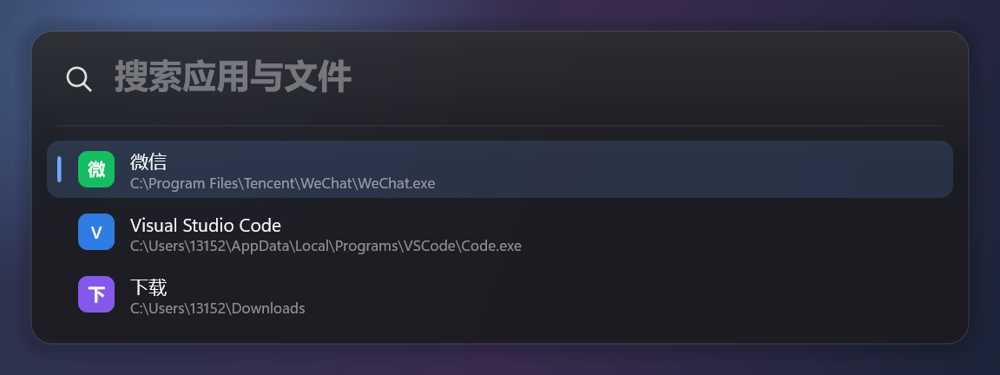
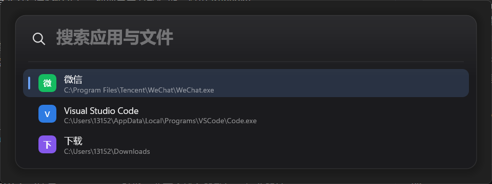

# eTools

Windows 11 上的高性能启动器（Spotlight / Raycast 风格）：热键唤出、输入即搜、回车启动应用与文件。C++20 + Win32 + Direct2D/DirectWrite + DirectComposition，免安装、免管理员、单 exe。

**当前进度：P1（视觉骨架 + 唤出链路）已完成，下一步 P2 输入与动效。**





## 系统要求

- **Windows 11 22H2（build 22621）及以上，x64**。只使用系统自带的云母/圆角与 DirectComposition，不提供 Win10 视觉回退。
- 免管理员、免安装；无外部运行库依赖（静态链接，UCRT 为系统组件）。
- 启动时校验系统版本，低于要求弹出明确提示并退出。

## 已实现

**P0：工具链与渲染闸门**

- 免安装 MinGW-w64 工具链获取脚本：下载、SHA256（GitHub API digest）校验、解压到 `.toolchain/`。
- 一键增量构建 `build.ps1`：资源/清单嵌入、`-static -s` 单文件；当前产物约 315KB，链接约 170ms。
- DirectComposition + D3D11 翻转模型合成交换链 + Direct2D：透明圆角窗口，真实桌面内容可透过面板（已用屏幕合成截图验证）。
- Win11 云母背景：`DWMWA_SYSTEMBACKDROP_TYPE` 在 DComp 窗口上生效。
- 离屏 PNG 自检：窗口与离屏共用同一份绘制代码。

**P1：视觉骨架 + 唤出链路**

- 模块化拆分：`core/`、`platform/`、`ui/`、`app/`（见下方目录）。
- 主题 token 化：暗/亮/跟随系统；尺寸、颜色、字号集中定义；默认强调色为设计蓝 `#6EA8FF`，可 `--accent=system` 跟随系统。
- 系统版本门禁（build ≥ 22621）、Per-Monitor V2 DPI、按光标显示器定位（水平居中、垂直 18%）。
- 全局热键 `Alt+Space`（冲突时自动尝试 `Ctrl+Alt+Space`、`Ctrl+Shift+Space`）；失焦自动隐藏、Esc 隐藏。
- 单实例：重复启动会把已有实例唤到前台。
- 隐藏预热渲染 + 同步出帧：**显示→首帧实测 14.1ms**（ShowWindow 12.2ms + 绘制 1.7ms）。
- 3 DPI × 2 主题基线矩阵：`docs/images/p1/baseline-{dark,light}-{100,150,200}.png`。

## 构建

```powershell
# 仅首次：下载并校验 MinGW-w64（264MB，解压约 1.5GB 到 .toolchain/，不写入系统 PATH）
node tools/fetch-toolchain.mjs

# 构建（执行策略受限时用 Bypass 形式；脚本输出为 ASCII，避免 PS 5.1 编码问题）
powershell -ExecutionPolicy Bypass -File .\build.ps1

# 调试构建 / 测试 / 构建后启动
powershell -ExecutionPolicy Bypass -File .\build.ps1 -Config Debug
powershell -ExecutionPolicy Bypass -File .\build.ps1 -Config Test
powershell -ExecutionPolicy Bypass -File .\build.ps1 -Run
```

## 运行

```powershell
.\build\eTools.exe                       # 常驻：按 Alt+Space 唤出/隐藏
.\build\eTools.exe --show --ms=3000      # 直接显示 3 秒（便于测试）
.\build\eTools.exe --capture=cap.png     # 显示并截取真实合成结果
.\build\eTools.exe --shot=out.png --scale=1.5 --theme=light
.\build\eTools.exe --shot-matrix=docs\images\p1   # 生成 3×2 基线矩阵
```

| 参数 | 说明 |
| --- | --- |
| `--show` | 启动后立即显示（否则等待热键） |
| `--ms=<n>` | 启动后 n 毫秒自动退出 |
| `--capture=<png>` | 显示约 0.45s 后截取窗口区域（含 DWM 合成结果） |
| `--shot=<png>` | 离屏渲染（模拟壁纸），不创建窗口 |
| `--shot-matrix=<dir>` | 生成 3 DPI × 2 主题基线 |
| `--theme=dark\|light\|system` | 主题，默认跟随系统 |
| `--accent=system\|#RRGGBB` | 强调色，默认设计蓝 `#6EA8FF` |
| `--query=<text>` | 预填输入框文字 |
| `--scale=<factor>` | 截图缩放（1 = 100%） |
| `--glass` | 面板不透明度降到 0.35，检查桌面透出 |
| `--no-hotkey` | 不注册全局热键 |
| `--log=<path>` | 指定日志文件（默认 `%LOCALAPPDATA%\eTools\logs`，不可写时退回 exe 同目录） |

## 目录

```
src/main.cpp               CLI 解析与入口分发
src/app/                   常驻应用：单实例、热键、显示/隐藏、截图模式
src/ui/window.cpp          窗口创建、云母/圆角、光标显示器定位、前台激活、预热
src/ui/renderer.cpp        D3D11/DXGI/DirectComposition/D2D/DWrite/WIC 与出图
src/ui/scene.cpp           面板绘制（阴影、输入区、结果行、光标）
src/ui/theme.cpp           暗/亮主题 token、强调色解析
src/platform/system.cpp    系统版本门禁、DPI、工作区、暗色/强调色读取
src/platform/hotkey.cpp    全局热键注册与候选组合
src/core/log.*             日志（文件/调试器/控制台，UTF-8）与通用工具
assets/app.rc              版本/清单资源
assets/app.manifest        Per-Monitor V2、长路径、UTF-8、asInvoker
tools/fetch-toolchain.mjs  工具链获取与校验（锁定版本）
build.ps1                  增量构建脚本
docs/DESIGN.md             架构决策、实测数据、视觉 token
docs/images/p1/            设计基线与真实合成截图
```

## 已知事项

- 链接时 binutils 2.47 会输出 `.rsrc merge failure: multiple non-default manifests`，属**非致命诊断**：清单与版本资源均已正确嵌入（`permonitorv2` 字符串可从 exe 中检出）。
- `build.ps1` 需以 `-ExecutionPolicy Bypass` 运行，或自行调整本机执行策略。
- 探针时代的 `--mica` 参数已移除（云母默认开启）；`--shot` 不校验系统版本，便于任意机器生成设计图。
- 输入框目前仍是静态占位（P2 实现自绘输入 + IME），列表为固定样例数据（P3 接真实索引）。

## 路线

| 阶段 | 内容 |
| --- | --- |
| P0 ✅ | 工具链、构建、DComp/D2D 透明窗口、离屏自检 |
| P1 ✅ | 模块化、主题 token、热键/定位/显隐、单实例、系统门禁、多 DPI 基线 |
| P2 | 自绘输入框 + IME、虚拟列表、键盘/滚动、唤出与选中动效 |
| P3 | 应用索引（开始菜单/AppsFolder/App Paths）、评分、启动、图标 |
| P4 | 文件索引（根目录、快照、watcher）、路径直通 |
| P5 | 设置窗、托盘、自启、图标缓存、打磨与文档 |
